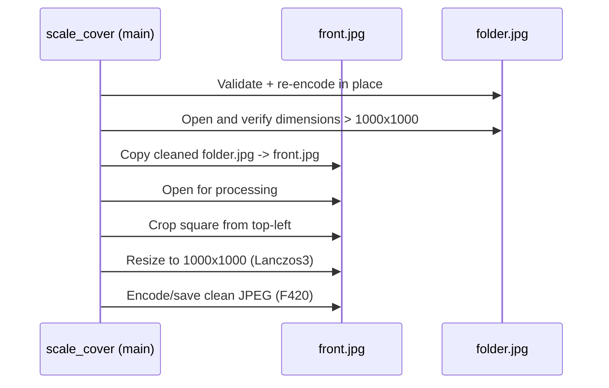

# audiotools-rs

## Table of Contents

- [Install](#install)
- [maintain_album_art](#maintain_album_art)
- [scale_cover](#scale_cover)
- [Last.fm scrobbler](#lastfm-scrobbler)

## Install

From the workspace root, install each application by path:

```bash
cargo install --path maintain-album-art
cargo install --path scale-cover
cargo install --path lastfm-scrobbler
```

## maintain_album_art

`maintain_album_art` scans a directory tree for `.flac` and `.mp3` files and reports whether each file contains embedded album art in its metadata.

### Purpose

- Quickly audit a music library for missing embedded cover art.
- Print per-file status so you can see which tracks need artwork.
- Print a summary count of total audio files (`.flac` + `.mp3`), files with art, and files missing art.

### Program Flow (`main`)

1. Read command-line arguments and require a target directory.
2. Validate that the provided path exists and is a directory.
3. Recursively walk through all entries under that directory using `walkdir`.
4. For each directory encountered, inspect only that directory’s immediate files and report any `.jpg`, `.jpeg`, or `.png` files with:
	- name
	- type
	- dimensions (`width × height`)
	- print `[DIR LEVEL OK]` when both `front.jpg` and `folder.jpg` exist and each image is at least `1000 × 1000`
	- print a separator line of 30 hyphens for directories that contain at least one `.flac`, `.mp3`, or `.m4a` file
5. Filter to regular files with a `.flac` or `.mp3` extension.
6. Read metadata (`metaflac` for FLAC, `id3` for MP3) and count embedded pictures.
7. Print one line per file:
	- `[FRONT 1000x1000]` when at least one embedded front cover is exactly `1000 × 1000`.
	- `[HAS ART, NO FRONT 1000x1000]` when images exist but none meet the front-cover size requirement.
	- `[MISSING]` when no image exists.
	- `[ERROR]` when metadata cannot be read.
8. Evaluate each audio directory as `COMPLETE OK` only when:
	- `front.jpg` is exactly `1000 × 1000`
	- `folder.jpg` is at least `1000 × 1000`
	- every scanned audio track (`.flac`/`.mp3`) has an embedded front cover image at `1000 × 1000`
9. Print final summary totals and a directory summary.
10. When `--skip-complete` is used, omit `COMPLETE OK` directories and suppress `OK` track lines/counts from summary output.

### How To Run

From the workspace root:

```bash
cargo run -p maintain_album_art -- <directory-to-scan>
```

Example:

```bash
cargo run -p maintain_album_art -- ~/Music
```

Quick help (same as `maintain_album_art --help`):

```text
Usage: maintain_album_art [--skip-complete] <directory-to-scan>

Options:
  --skip-complete    Omit fully complete directories and suppress OK track lines/counts from summary output
```

Logging is standardized and written to stdout with levels (`INFO`, `WARN`, `ERROR`, `DEBUG`, `TRACE`).
Use `RUST_LOG` to control verbosity, for example:

```bash
RUST_LOG=debug cargo run -p maintain_album_art -- ~/Music
RUST_LOG=trace cargo run -p maintain_album_art -- ~/Music
```

Skip complete directories in directory summary:

```bash
cargo run -p maintain_album_art -- --skip-complete ~/Music
```

Optional: build first, then run the binary:

```bash
cargo build -p maintain_album_art
./target/debug/maintain_album_art ~/Music
```

## scale_cover

`scale_cover` uses `folder.jpg` as input origin for every run. It validates and normalizes `folder.jpg`, copies the cleaned `folder.jpg` to `front.jpg`, then scales `front.jpg` to exactly `1000x1000`.

### Purpose

- Quickly produce a standardized square cover image size for downstream use.
- Keep a cleaned, unscaled copy of the validated image as `folder.jpg`.
- Reject invalid or non-JPEG inputs before processing.
- Reject images that are too small to meet the `1000x1000` output requirement.

### Program Flow (`main`)

1. Use fixed input and output file names:
	- Input origin: `folder.jpg`
	- Output: `front.jpg`
2. Validate `folder.jpg` by decoding with `zune-jpeg` and re-encode it with `jpeg-encoder` (`F420` subsampling) back into `folder.jpg`.
3. Open `folder.jpg` and require both dimensions to be greater than `1000` pixels.
4. Copy cleaned `folder.jpg` to `front.jpg`.
5. Open `front.jpg` for image processing.
6. Crop to a square using the smaller side length, anchored at `(0, 0)`.
7. Resize cropped image exactly to `1000x1000` using `Lanczos3` filtering.
8. Save the scaled result as `front.jpg` using `jpeg-encoder` (`F420` subsampling).

### Flow Diagram (Mermaid)



### How To Run

From the workspace root (with `folder.jpg` in your current directory):

```bash
cargo run -p scale_cover
```

Optional: build first, then run the binary:

```bash
cargo build -p scale_cover
./target/debug/scale_cover
```

## Last.fm scrobbler

See [docs/lastfm-scrobbler.md](docs/lastfm-scrobbler.md) for setup and service instructions.
