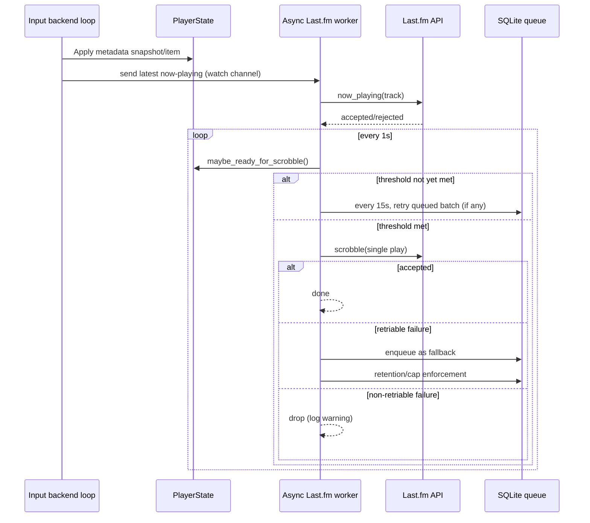
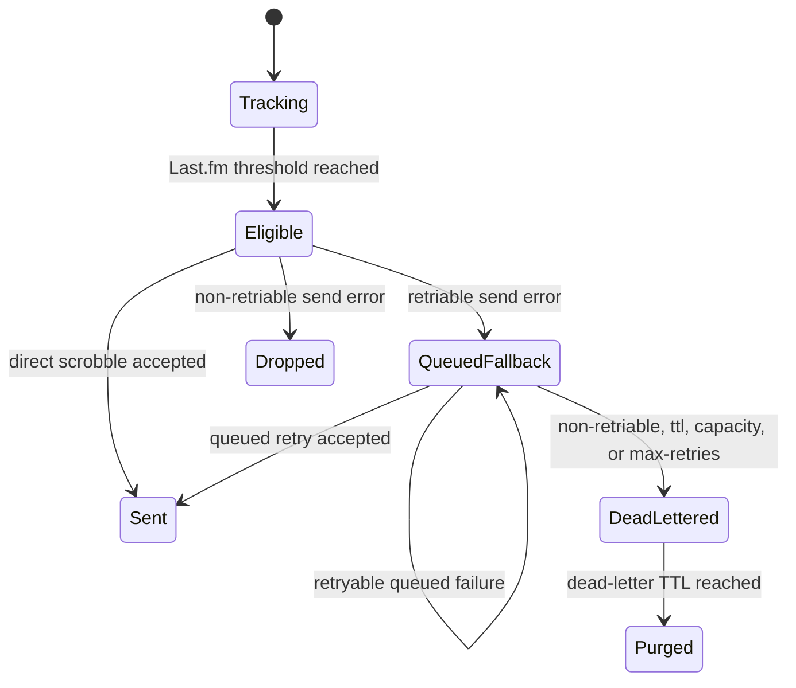

# lastfm-scrobbler

This workspace application reads playback metadata from Shairport Sync and/or
MPD, sends Last.fm “Now Playing” updates, and attempts to scrobble recognized
tracks.

The package manifest is at `lastfm-scrobbler/Cargo.toml`; its implementation is
in [`src/main.rs`](../lastfm-scrobbler/src/main.rs). Run the following commands
from the workspace root.

## Requirements

- Shairport Sync with at least one metadata interface enabled (`pipe`, native
  DBus, or MPRIS).
- A Last.fm account and API key/shared secret.
- The Last.fm account username and password used for password authentication.
- Select an input mode via `LASTFM_INPUT_BACKEND` (`pipe`, `dbus`, `mpris`, or
  `auto`; default is `pipe`). See
  [Input backend configuration](#input-backend-configuration).

For local/offline preparation without real Last.fm credentials, set
`LASTFM_OFFLINE_MODE=1`. In offline mode the app still reads and parses
metadata, but skips Last.fm authentication and API calls.

Failed scrobbles are queued in SQLite for retries. By default the queue
database is `/var/lib/shairport-scrobbler/scrobble-queue.sqlite3`. Override via
`LASTFM_QUEUE_DB` if needed.
Queue hardening defaults:
- SQLite `journal_mode=WAL` (for file-backed DBs)
- SQLite busy timeout: `LASTFM_QUEUE_BUSY_TIMEOUT_MS` (default `5000`)
- Queue TTL: `LASTFM_QUEUE_TTL_SECS` (default `604800`, 7 days)
- Queue max rows: `LASTFM_QUEUE_MAX_ITEMS` (default `10000`)
- Max retries per queued row: `LASTFM_QUEUE_MAX_RETRIES` (default `20`)
- Dead-letter TTL: `LASTFM_DEAD_LETTER_TTL_SECS` (default `2592000`, 30 days)

Logging uses standard Rust log levels (`error`, `warn`, `info`, `debug`,
`trace`) and is controlled with `RUST_LOG` (default level is `info`).
At `info` level, outgoing Last.fm `now_playing` and `scrobble` submissions log
track metadata (`title`, `artist`, `album`).
At `info` level, successful Last.fm responses are also logged as accepted
(`Last.fm accepted ...`), including normalized response metadata and scrobble
timestamp.

### Input backend configuration

Set one backend in the service:

```ini
Environment="LASTFM_INPUT_BACKEND=pipe"
```

or

```ini
Environment="LASTFM_INPUT_BACKEND=dbus"
```

or

```ini
Environment="LASTFM_INPUT_BACKEND=mpris"
```

or

```ini
Environment="LASTFM_INPUT_BACKEND=auto"
```

Configure environment variables for the selected backend:
- `pipe`: `SHAIRPORT_PIPE`
- `dbus`: `SHAIRPORT_DBUS_BUS`, `SHAIRPORT_DBUS_SERVICE`,
  `SHAIRPORT_DBUS_PATH`
- `mpris`: `MPRIS_BUS`, `MPRIS_SERVICE`, `MPRIS_PATH`
- `auto`: MPD + Shairport source arbitration:
  - `LASTFM_AUTO_SHAIRPORT_BACKEND` (`pipe`, `dbus`, or `mpris`; default
    `pipe`)
  - MPD endpoint: `MPD_HOST` (default `127.0.0.1`), `MPD_PORT` (default
    `6600`), optional `MPD_PASSWORD`

Note: the `pipe` backend currently supports Shairport Sync metadata format
only (XML/DMAP items from Shairport's metadata pipe).

If `dbus` or `mpris` is selected, leave `SHAIRPORT_PIPE` unset. If `pipe` is
selected, leave DBus/MPRIS override variables unset.
If `auto` is selected, configure Shairport variables according to
`LASTFM_AUTO_SHAIRPORT_BACKEND`.

#### Automatic source arbitration (`LASTFM_INPUT_BACKEND=auto`)

In `auto` mode, `lastfm-scrobbler` runs separate workers for:
- MPD (event-driven via MPD `idle player` events)
- Shairport Sync (via the selected Shairport backend)

The source arbiter keeps one active source at a time:
- it stays on the current active source while that source is actively playing
  and provides artist/title metadata,
- it switches when the active source becomes inactive and another source is
  active.

This prevents duplicate now-playing/scrobble transitions when both sources
report the same track.

### Getting metadata from Shairport Sync

1. Edit Shairport Sync config and enable metadata output to a named pipe.
   - User-service setup (recommended here): `~/.config/shairport-sync/shairport-sync.conf`
   - System-service setup: `/etc/shairport-sync.conf`
   Replace `<UID>` with your numeric user id (`id -u`).
   Example:

   ```conf
   metadata =
   {
       enabled = "yes";
       include_cover_art = "no";
       pipe_name = "/run/user/<UID>/shairport-sync-metadata";
   };
   ```

2. Restart Shairport Sync:

   ```bash
   systemctl --user restart shairport-sync
   ```

3. Confirm the metadata pipe exists:

   ```bash
   ls -l /run/user/<UID>/shairport-sync-metadata
   ```

4. Verify metadata is flowing while AirPlay playback is active:

   ```bash
   timeout 60s cat /run/user/<UID>/shairport-sync-metadata
   ```

   You should see XML `<item>...</item>` records.

   **Warning:** only read the pipe directly while the `lastfm-scrobbler`
   service is **stopped**. A FIFO delivers each byte to exactly one reader, so
   a second reader (such as `cat`) steals metadata items from the service.
   This causes missing or partial tracks (e.g. empty album fields) and skipped
   scrobbles. While the service is running, monitor it via the journal
   instead:

   ```bash
   journalctl -u lastfm-scrobbler -f --no-pager
   ```

5. If you use a different pipe path, set it for this service:

   ```ini
   Environment="SHAIRPORT_PIPE=/your/pipe/path"
   ```

6. Ensure Shairport metadata includes track fields used by this app:
   - `core/minm` (title)
   - `core/asar` (artist)
   - `core/asal` (album)
   - `ssnc/mdst` and `ssnc/mden` (metadata block boundaries)

### Using native DBus input

1. Select DBus mode in the service:

   ```ini
   Environment="LASTFM_INPUT_BACKEND=dbus"
   ```

2. Keep defaults or override if your Shairport instance uses custom names:

   ```ini
   # Optional; defaults shown:
   # Environment="SHAIRPORT_DBUS_BUS=system"
   # Environment="SHAIRPORT_DBUS_SERVICE=org.gnome.ShairportSync"
   # Environment="SHAIRPORT_DBUS_PATH=/org/gnome/ShairportSync"
   ```

3. Ensure Shairport Sync is built/configured with DBus interface support.

### Using MPRIS input

1. Select MPRIS mode in the service:

   ```ini
   Environment="LASTFM_INPUT_BACKEND=mpris"
   ```

2. Keep defaults or override:

   ```ini
   # Optional; defaults shown:
   # Environment="MPRIS_BUS=system"
   # Environment="MPRIS_SERVICE=org.mpris.MediaPlayer2.ShairportSync"
   # Environment="MPRIS_PATH=/org/mpris/MediaPlayer2"
   ```

3. Ensure Shairport Sync is built/configured with MPRIS interface support.

### Detailed setup: MPD via MPRIS

Use this path when you want to scrobble tracks played by MPD. The
`lastfm-scrobbler` process reads MPRIS metadata, so MPD must expose an MPRIS
service (commonly through `mpDris2`).

If you also run Shairport Sync and want automatic switching between MPD and
Shairport, use `LASTFM_INPUT_BACKEND=auto` instead of `mpris` and set
`LASTFM_AUTO_SHAIRPORT_BACKEND` for the Shairport side.

Package names by distro:

| Distro | MPD package | MPRIS bridge package |
| --- | --- | --- |
| Debian/Ubuntu | `mpd` | `mpdris2` |
| Arch Linux | `mpd` | `mpDris2` (AUR) |
| Fedora | `mpd` | `mpdris2` |

1. Install and start MPD.

  Example (Debian/Ubuntu):

  ```bash
  sudo apt install mpd
  systemctl --user enable --now mpd
  systemctl --user status mpd --no-pager
  ```

2. Install and start an MPD-to-MPRIS bridge.

  Example (`mpDris2`):

  ```bash
  sudo apt install mpdris2
  systemctl --user enable --now mpdris2
  systemctl --user status mpdris2 --no-pager
  ```

3. Discover the active MPRIS service name.

  ```bash
  busctl --user list | grep -E 'org\.mpris\.MediaPlayer2'
  ```

  Typical MPD service names include:
  - `org.mpris.MediaPlayer2.mpd`
  - `org.mpris.MediaPlayer2.mpdris2`

4. Verify MPRIS metadata and playback status are visible.

  ```bash
  busctl --user get-property \
    org.mpris.MediaPlayer2.mpd \
    /org/mpris/MediaPlayer2 \
    org.mpris.MediaPlayer2.Player PlaybackStatus

  busctl --user get-property \
    org.mpris.MediaPlayer2.mpd \
    /org/mpris/MediaPlayer2 \
    org.mpris.MediaPlayer2.Player Metadata
  ```

  Replace `org.mpris.MediaPlayer2.mpd` with the discovered service name.

5. Configure `lastfm-scrobbler` to use MPRIS and the discovered MPD service.

  In the service unit or drop-in:

  ```ini
  Environment="LASTFM_INPUT_BACKEND=mpris"
  Environment="MPRIS_BUS=session"
  Environment="MPRIS_SERVICE=org.mpris.MediaPlayer2.mpd"
  Environment="MPRIS_PATH=/org/mpris/MediaPlayer2"
  ```

  Notes:
  - MPD MPRIS is usually on the session bus, so `MPRIS_BUS=session` is
    typically required.
  - If your bridge exports a different service name, set `MPRIS_SERVICE`
    accordingly.

6. Reload and restart the scrobbler service.

  ```bash
  systemctl --user daemon-reload
  systemctl --user restart lastfm-scrobbler
  systemctl --user status lastfm-scrobbler --no-pager
  ```

7. Validate end-to-end behavior while playing music in MPD.

  ```bash
  journalctl --user -u lastfm-scrobbler -f --no-pager
  ```

  Look for log lines similar to:
  - `Using MPRIS backend on session bus: ...`
  - `Now Playing: Artist - Title (Album)`
  - `Last.fm accepted now playing: ...`
  - `Last.fm accepted scrobble: ...`

Troubleshooting:
- If no MPRIS service appears, ensure `mpdris2` is running as the same user
  session that owns MPD.
- If metadata is empty, confirm MPD files contain artist/title tags.
- If scrobbler cannot see user-session DBus, run it as a user service or
  provide access to the user bus in your deployment model.

### Last.fm API key and authentication

1. Create a Last.fm API application and copy its API key and shared secret:
   - Sign in to Last.fm.
   - Open the API account creation page at
     <https://www.last.fm/api/account/create>.
   - Submit the form and copy the generated values.

2. Configure all required Last.fm environment variables in the systemd service:

   ```ini
   Environment="LASTFM_API_KEY=your_api_key"
   Environment="LASTFM_API_SECRET=your_api_secret"
   Environment="LASTFM_USERNAME=your_lastfm_username"
   Environment="LASTFM_PASSWORD=your_lastfm_password"
   ```

   For production deployments, prefer encrypted systemd credentials and
   file-based secret loading instead of inline secrets in unit files (see
   [Using encrypted systemd credentials (recommended)](#using-encrypted-systemd-credentials-recommended)).

3. Reload and restart the service after updating credentials:

   ```bash
   systemctl --user daemon-reload
   systemctl --user restart lastfm-scrobbler
   ```

4. Verify authentication succeeded:

   ```bash
   journalctl --user -u lastfm-scrobbler -n 100 --no-pager
   ```

   On successful startup, the app logs:
   `Successfully authenticated with Last.fm.`

Authentication details for this application:
- It uses Last.fm password authentication at startup (not browser OAuth).
- It authenticates once, then sends `now_playing` and `scrobble` requests with
  the authenticated session.
- Missing or invalid credentials cause startup failure. Credentials can be
  provided via `LASTFM_API_KEY`, `LASTFM_API_SECRET`, `LASTFM_USERNAME`,
  `LASTFM_PASSWORD`, or via file-based variants:
  `LASTFM_API_KEY_FILE`, `LASTFM_API_SECRET_FILE`, `LASTFM_USERNAME_FILE`,
  `LASTFM_PASSWORD_FILE`. If file variables are unset and
  `CREDENTIALS_DIRECTORY` is set, the app also auto-loads:
  `lastfm_api_key`, `lastfm_api_secret`, `lastfm_username`,
  `lastfm_password`.

## Build

```bash
cargo build --release -p lastfm-scrobbler
sudo install -m 755 target/release/lastfm-scrobbler /usr/local/bin/
```

## Run as `systemd --user` services (headless-safe full stack)

This is the recommended deployment for headless systems when you run:
- `mpd`
- `mpdris2`
- `lastfm-scrobbler`
- `shairport-sync`
- `snapserver`
- `snapclient`

Using one dedicated user for all of them keeps DBus/session access consistent
(`mpdris2` + MPRIS + `lastfm-scrobbler`) and avoids cross-bus/system-vs-user
permission issues.

### 1. Create/use a dedicated audio user and keep user services alive

Replace `<USER>` with your service account (for example `audio`).

`systemd --user` services normally stop when no login session exists. On
headless systems, enable lingering so the per-user systemd manager keeps
running at boot and after logout:

```bash
sudo loginctl enable-linger <USER>
loginctl show-user <USER> -p Linger
```

Expected output includes `Linger=yes`.

To disable this behavior later:

```bash
sudo loginctl disable-linger <USER>
```

### 2. Install required packages

Debian/Ubuntu example:

```bash
sudo apt update
sudo apt install mpd mpdris2 shairport-sync snapserver snapclient
```

### Package updates: preserving custom configuration

Yes, custom configuration can be preserved across Debian package updates, if you
keep local changes in the right locations.

What package updates usually do:
- `/etc/mpd.conf` and `/etc/shairport-sync.conf` are package conffiles. Local
  edits are not silently overwritten; `dpkg` asks how to handle conflicts.
- Vendor unit files under `/lib/systemd/system/*.service` are replaced on
  updates.
- User files under `~/.config/...` are not managed by `apt`/`dpkg`.

How to fulfill this requirement reliably:
1. Keep your active service configs in user space:
   - `~/.config/mpd/mpd.conf`
   - `~/.config/shairport-sync/shairport-sync.conf`
2. Keep custom user units in:
   - `~/.config/systemd/user/`
3. Do not edit vendor units in `/lib/systemd/system`; use overrides instead:
   - system services: `sudo systemctl edit <service>`
   - user services: `systemctl --user edit <service>`
4. After package upgrades, verify service health:

   ```bash
   systemctl --user status mpd mpdris2 shairport-sync snapserver snapclient lastfm-scrobbler --no-pager
   journalctl --user -u mpd -u shairport-sync -u lastfm-scrobbler -n 100 --no-pager
   ```

Optional but recommended:
- Keep `~/.config/mpd/`, `~/.config/shairport-sync/`, and
  `~/.config/systemd/user/` in version control.

### 3. Build and install `lastfm-scrobbler` for that user

Run as `<USER>` (not root):

```bash
cargo build --release -p lastfm-scrobbler
install -d -m 755 ~/.local/bin
install -m 755 target/release/lastfm-scrobbler ~/.local/bin/lastfm-scrobbler
```

### 4. Prepare config and runtime paths

Run as `<USER>`:

```bash
id -u
install -d -m 700 ~/.config/mpd ~/.config/shairport-sync ~/.config/snapserver ~/.config/systemd/user
```

Save your numeric UID from `id -u` as `<UID>` for the next configs.

### 5. Create minimal config files

`~/.config/mpd/mpd.conf`:

```conf
music_directory "~/Music"
playlist_directory "~/.config/mpd/playlists"
db_file "~/.config/mpd/database"
log_file "~/.config/mpd/log"
pid_file "~/.config/mpd/pid"
state_file "~/.config/mpd/state"
sticker_file "~/.config/mpd/sticker.sql"

bind_to_address "127.0.0.1"
port "6600"

audio_output {
    type "alsa"
    name "default"
}
```

`~/.config/shairport-sync/shairport-sync.conf`:

```conf
general =
{
    name = "Headless AirPlay";
};

metadata =
{
    enabled = "yes";
    include_cover_art = "no";
    pipe_name = "/run/user/<UID>/shairport-sync-metadata";
};

audio =
{
    output_backend = "pipe";
};

pipe =
{
    name = "/run/user/<UID>/snapfifo";
    audio_backend_latency_offset = 0;
};
```

`~/.config/snapserver/snapserver.conf`:

```conf
[stream]
source = pipe:///run/user/<UID>/snapfifo?name=AirPlay&mode=read
```

### 6. Create user service units

Create these files under `~/.config/systemd/user/`.

`mpd.service`:

```ini
[Unit]
Description=Music Player Daemon
After=network-online.target sound.target
Wants=network-online.target

[Service]
Type=simple
ExecStart=/usr/bin/mpd --no-daemon %h/.config/mpd/mpd.conf
Restart=on-failure
RestartSec=2

[Install]
WantedBy=default.target
```

`mpdris2.service`:

```ini
[Unit]
Description=MPD to MPRIS bridge
After=mpd.service
Requires=mpd.service

[Service]
Type=simple
ExecStart=/usr/bin/mpdris2
Restart=on-failure
RestartSec=2

[Install]
WantedBy=default.target
```

If your distro installs the binary as `mpDris2`, change `ExecStart` to
`/usr/bin/mpDris2`.

`shairport-sync.service`:

```ini
[Unit]
Description=Shairport Sync (AirPlay receiver)
After=network-online.target sound.target
Wants=network-online.target

[Service]
Type=simple
ExecStartPre=/usr/bin/test -p /run/user/%U/snapfifo || /usr/bin/mkfifo /run/user/%U/snapfifo
ExecStartPre=/usr/bin/test -p /run/user/%U/shairport-sync-metadata || /usr/bin/mkfifo /run/user/%U/shairport-sync-metadata
ExecStart=/usr/bin/shairport-sync -c %h/.config/shairport-sync/shairport-sync.conf
Restart=on-failure
RestartSec=2

[Install]
WantedBy=default.target
```

`snapserver.service`:

```ini
[Unit]
Description=Snapcast server
After=network-online.target shairport-sync.service
Wants=network-online.target
Requires=shairport-sync.service

[Service]
Type=simple
ExecStart=/usr/bin/snapserver --config %h/.config/snapserver/snapserver.conf
Restart=on-failure
RestartSec=2

[Install]
WantedBy=default.target
```

`snapclient.service`:

```ini
[Unit]
Description=Snapcast client
After=snapserver.service
Requires=snapserver.service

[Service]
Type=simple
ExecStart=/usr/bin/snapclient --host 127.0.0.1
Restart=on-failure
RestartSec=2

[Install]
WantedBy=default.target
```

`lastfm-scrobbler.service`:

```ini
[Unit]
Description=lastfm-scrobbler
After=network-online.target mpdris2.service
Wants=network-online.target
Requires=mpdris2.service

[Service]
Type=simple
Environment="LASTFM_INPUT_BACKEND=auto"
Environment="LASTFM_AUTO_SHAIRPORT_BACKEND=pipe"
Environment="MPD_HOST=127.0.0.1"
Environment="MPD_PORT=6600"
# Optional if MPD requires password authentication:
# Environment="MPD_PASSWORD=your_mpd_password"
# Optional if you choose dbus/mpris for LASTFM_AUTO_SHAIRPORT_BACKEND:
# Environment="SHAIRPORT_DBUS_BUS=session"
# Environment="SHAIRPORT_DBUS_SERVICE=org.gnome.ShairportSync"
# Environment="SHAIRPORT_DBUS_PATH=/org/gnome/ShairportSync"
# Environment="MPRIS_BUS=session"
# Environment="MPRIS_SERVICE=org.mpris.MediaPlayer2.ShairportSync"
# Environment="MPRIS_PATH=/org/mpris/MediaPlayer2"
# For production, prefer encrypted credentials (section below).
Environment="LASTFM_API_KEY=your_api_key"
Environment="LASTFM_API_SECRET=your_api_secret"
Environment="LASTFM_USERNAME=your_username"
Environment="LASTFM_PASSWORD=your_password"
# Optional:
# Environment="RUST_LOG=info"
ExecStart=%h/.local/bin/lastfm-scrobbler
Restart=always
RestartSec=5

[Install]
WantedBy=default.target
```

If `busctl --user list | grep -E 'org\.mpris\.MediaPlayer2'` shows a different
MPRIS service name, set `MPRIS_SERVICE` to that value (when using MPRIS input).

### 7. Enable and start all user services

```bash
systemctl --user daemon-reload
systemctl --user enable --now mpd mpdris2 shairport-sync snapserver snapclient lastfm-scrobbler
systemctl --user status mpd mpdris2 shairport-sync snapserver snapclient lastfm-scrobbler --no-pager
```

### 8. Validate the stack end-to-end

Check MPRIS visibility:

```bash
busctl --user list | grep -E 'org\.mpris\.MediaPlayer2'
```

Check all logs:

```bash
journalctl --user -u mpd -u mpdris2 -u shairport-sync -u snapserver -u snapclient -u lastfm-scrobbler -n 200 --no-pager
```

Follow scrobbler logs live:

```bash
journalctl --user -u lastfm-scrobbler -f --no-pager
```

Look for:
- `Auto input mode enabled. Shairport backend=..., MPD idle-events enabled.`
- `Connected to MPD at 127.0.0.1:6600`
- `Active playback source switched to ...`
- `Now Playing: Artist - Title (Album)`
- `Last.fm accepted now playing: ...`
- `Last.fm accepted scrobble: ...`

### 9. Common headless troubleshooting

- `Failed to connect to session DBus`: ensure lingering is enabled and the
  service runs as the intended user account.
- `Waiting for MPD at ...`: verify `mpd` is running, and `MPD_HOST`/`MPD_PORT`
  match your MPD listener.
- No `org.mpris.MediaPlayer2.*`: verify `mpdris2` is running and connected to
  the same `mpd` instance.
- `snapserver` cannot read FIFO: verify `<UID>` in config paths and that
  `/run/user/<UID>/snapfifo` exists.
- Missing tags in scrobbles: confirm MPD files contain artist/title metadata.
- If you change unit files, always run:

  ```bash
  systemctl --user daemon-reload
  systemctl --user restart <service>
  ```

## Using encrypted systemd credentials (recommended)

This avoids keeping Last.fm secrets directly in unit `Environment=...` values.
With current `lastfm-scrobbler`, no wrapper script is required.

### 1. Create encrypted credential files

Create the encrypted credential store directory:

```bash
install -d -m 700 ~/.config/credstore.encrypted
```

Encrypt each secret into its own file:

```bash
read -rsp "LASTFM_API_KEY: " V; echo;    printf '%s' "$V" | systemd-creds encrypt - ~/.config/credstore.encrypted/lastfm_api_key; unset V
read -rsp "LASTFM_API_SECRET: " V; echo; printf '%s' "$V" | systemd-creds encrypt - ~/.config/credstore.encrypted/lastfm_api_secret; unset V
read -rsp "LASTFM_USERNAME: " V; echo;   printf '%s' "$V" | systemd-creds encrypt - ~/.config/credstore.encrypted/lastfm_username; unset V
read -rsp "LASTFM_PASSWORD: " V; echo;   printf '%s' "$V" | systemd-creds encrypt - ~/.config/credstore.encrypted/lastfm_password; unset V

chmod 600 ~/.config/credstore.encrypted/*
```

### 2. Configure service override

Create/edit a drop-in:

```bash
systemctl --user edit lastfm-scrobbler
```

Drop-in files for this service are stored in:

`~/.config/systemd/user/lastfm-scrobbler.service.d/`

Naming:
- default (recommended): `override.conf`
- split configuration: `10-credentials.conf`, `20-hardening.conf`, etc.

Systemd loads `*.conf` drop-ins in lexical order.

Add:

```ini
[Service]
UnsetEnvironment=LASTFM_API_KEY LASTFM_API_SECRET LASTFM_USERNAME LASTFM_PASSWORD

LoadCredentialEncrypted=lastfm_api_key:%h/.config/credstore.encrypted/lastfm_api_key
LoadCredentialEncrypted=lastfm_api_secret:%h/.config/credstore.encrypted/lastfm_api_secret
LoadCredentialEncrypted=lastfm_username:%h/.config/credstore.encrypted/lastfm_username
LoadCredentialEncrypted=lastfm_password:%h/.config/credstore.encrypted/lastfm_password
```

### 3. Reload and restart

```bash
systemctl --user daemon-reload
systemctl --user restart lastfm-scrobbler
systemctl --user status lastfm-scrobbler --no-pager
systemctl --user cat lastfm-scrobbler --no-pager
```

### 4. Verify no secrets are exposed in unit environment

```bash
systemctl --user show lastfm-scrobbler -p Environment --no-pager
journalctl --user -u lastfm-scrobbler -n 50 --no-pager
```

### Optional: explicit file-variable mapping

If you do not want to rely on `CREDENTIALS_DIRECTORY` auto-discovery, map each
credential explicitly:

```ini
[Service]
Environment="LASTFM_API_KEY_FILE=%d/lastfm_api_key"
Environment="LASTFM_API_SECRET_FILE=%d/lastfm_api_secret"
Environment="LASTFM_USERNAME_FILE=%d/lastfm_username"
Environment="LASTFM_PASSWORD_FILE=%d/lastfm_password"
```

`%d` expands to the service credentials directory.

## How `systemd-creds` encrypt/decrypt works

- `systemd-creds encrypt` stores encrypted blobs in
  `~/.config/credstore.encrypted/`.
- `LoadCredentialEncrypted=` tells systemd to decrypt those blobs at service
  start.
- Decrypted values are exposed as files under `$CREDENTIALS_DIRECTORY`
  (runtime path under `/run/credentials/...`) for that service.
- `lastfm-scrobbler` can read these files directly (via
  `CREDENTIALS_DIRECTORY` auto-discovery or `LASTFM_*_FILE` variables).
- At stop/restart, runtime credential files are removed and recreated.

Manual admin decrypt example:

```bash
systemd-creds decrypt ~/.config/credstore.encrypted/lastfm_api_key -
```

## Runtime flow

The service uses two concurrent paths:
- **Input loop (sync):** reads metadata (`pipe`/`dbus`/`mpris`) and updates
  local playback state.
- **Last.fm worker (async):** receives coalesced now-playing updates and handles
  scrobble send/retry logic.

### Sequence diagram



### Scrobble state diagram



## Behavior

- Reads metadata from exactly one selected backend: `pipe`, `dbus`, or
  `mpris`.
- In `pipe` mode, decodes Shairport XML/Base64 metadata items (Shairport Sync
  format only).
- Uses the `core` DMAP fields `minm` (title), `asar` (artist), and `asal`
  (album). The `ssnc` events `mdst` and `mden` delimit metadata blocks.
- Sends a “Now Playing” update when a new track is recognized. The `pend` and
  `pfls` events mark playback stopped or paused; `prsm` and `pbeg` mark it
  resumed or started.
- Applies Last.fm scrobble thresholds:
  - tracks with duration `<= 30s` are not scrobbled
  - tracks `> 30s` are scrobbled after at least half the track duration or
    4 minutes, whichever comes first
  - if duration metadata is missing, falls back to a 30-second threshold
  - only active playback time counts toward the threshold (paused time does not)
- Scrobbles are sent to Last.fm immediately once threshold conditions are met.
- Failed **retriable** scrobble submissions are stored in a local SQLite queue
  as a fallback and retried periodically in batches (up to 50 tracks per
  request).
- Queue hardening is enabled:
  - file-backed SQLite queue uses WAL mode
  - DB operations use a configurable busy timeout
  - queue rows older than the configured queue TTL are moved to dead letter
  - queue size is bounded; oldest overflow rows are moved to dead letter
  - queued rows that exceed max retries are moved to dead letter
  - dead-letter rows are purged after the configured dead-letter TTL
- Retry handling is error-classified:
  - temporary service/network failures are retried
  - invalid session errors trigger re-authentication and retry
  - non-retriable queued request failures are moved to dead letter
- Retries opening the metadata pipe every three seconds if it is unavailable.

If Spotify is also linked to Last.fm and streamed to the Pi over AirPlay,
disable one of the scrobbling paths to avoid duplicate Spotify scrobbles.
