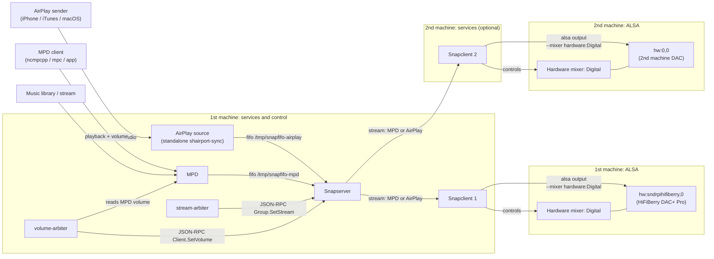
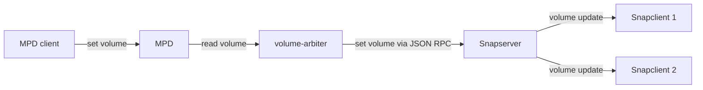

# snapcast setup (server + client) with HiFiBerry DAC+ Pro

This guide configures the first machine (`card 0: sndrpihifiberry`) to route
MPD and standalone Shairport Sync AirPlay into Snapcast, with an optional
Snapclient on a second machine.

## Goal and topology

- Shairport Sync runs as a standalone service and writes AirPlay audio to a
  fixed FIFO consumed by Snapserver.
- MPD writes to a FIFO stream for Snapserver.
- Snapserver distributes both streams (`MPD` and `AirPlay`).
- Snapclient can run on the same machine using ALSA output with hardware mixer
  control (`Digital`).
- Optional: run a second Snapclient on a second machine with its own ALSA DAC
  and hardware mixer.

Because MPD and Snapclient can control the same hardware mixer, use one clear
volume-control policy (for example `volume-arbiter`).

## Wiring diagram (components and audio sources)



## 1. AirPlay source (standalone `shairport-sync` with fixed metadata)

Use standalone `shairport-sync` to get a stable DBus/metadata interface for
`lastfm-scrobbler`, and write AirPlay audio into a dedicated FIFO for
Snapserver.

In [/etc/shairport-sync.conf](/etc/shairport-sync.conf), set:

```conf
general = {
    name = "Snapcast";
    port = 7000;
    output_backend = "pipe";
}

pipe = {
    name = "/tmp/snapfifo-airplay";
};

metadata = {
    enabled = "yes";
    include_cover_art = "no";
    pipe_name = "/tmp/shairport-sync-metadata";
};
```

Enable/start the standalone service:

```bash
sudo -A systemctl enable --now shairport-sync
```

## 2. MPD (local ALSA + Snapcast FIFO output)

In [/etc/mpd.conf](/etc/mpd.conf), add/update these `audio_output` blocks:

```conf
# use this block only if MPD should feed DAC locally 
# audio_output {
#    type            "alsa"
#    name            "HiFiBerry DAC+ Pro (local)"
#    device          "hw:sndrpihifiberry,0"
#    mixer_type      "hardware"
#    mixer_device    "hw:sndrpihifiberry"
#    mixer_control   "Digital"
# }

audio_output {
    type            "fifo"
    name            "Snapcast MPD"
    path            "/tmp/snapfifo-mpd"
    format          "48000:24:2"
}
```

## 3. Snapserver (read MPD FIFO + standalone AirPlay FIFO)

In [/etc/snapserver.conf](/etc/snapserver.conf), set stream sources:

```conf
[stream]
source = pipe:///tmp/snapfifo-mpd?name=MPD&mode=read&sampleformat=48000:24:2&codec=flac
source = pipe:///tmp/snapfifo-airplay?name=AirPlay&mode=read&sampleformat=44100:16:2&codec=flac
```

## 4. Snapclient on same machine (ALSA output with hardware mixer)

In [/etc/default/snapclient](/etc/default/snapclient), keep/use:

```bash
SNAPCLIENT_OPTS="--host 127.0.0.1 --player alsa --soundcard hw:sndrpihifiberry,0 --mixer hardware:Digital"
```

Why: `--mixer hardware:Digital` lets Snapclient control the HiFiBerry hardware
volume from Snapcast.

## 5. Optional: Snapclient on 2nd machine (ALSA + hardware mixer)

On the second machine, point Snapclient to the first machine's Snapserver and
use that machine's local ALSA DAC (`hw:0,0` in the diagram).

In `/etc/default/snapclient` on the second machine, use:

```bash
SNAPCLIENT_OPTS="--host <SNAPSERVER_IP> --player alsa --soundcard hw:0,0 --mixer hardware:Digital"
```

Enable/start Snapclient on the second machine:

```bash
sudo -A systemctl enable --now snapclient
```

Then restart Snapclient after config changes:

```bash
sudo -A systemctl restart snapclient
```

If the mixer control name differs, list available controls on the second
machine:

```bash
amixer -c 0 scontrols
```

and replace `hardware:Digital` with the correct control name.

## 6. Select stream on each client

Each Snapclient can play one Snapserver stream at a time (for example `MPD` or
`AirPlay`). Select the stream from Snapcast control UI/CLI.

## 6a. User-selected zone combinations + automatic source selection

Use Snapcast groups for the zone combination (chosen by user), and
`stream-arbiter` for automatic source selection (`MPD` vs `AirPlay`) per group.

User-selectable playback combinations:

- `1st machine only`: group contains only Snapclient 1
- `2nd machine only`: group contains only Snapclient 2
- `1st + 2nd`: both clients in one group

Recommended branches:

### Branch A (recommended): dynamic user grouping, arbiter manages all groups

- Users create/split/merge groups freely in Snapcast UI.
- `stream-arbiter` runs with `ARBITER_TARGET_GROUPS` unset, so every current
  group is auto-switched to the highest-priority active source.

Use this when users should be free to change zone combinations at any time.

### Branch B: fixed managed groups only

- Keep stable groups (for example one per room).
- Set `ARBITER_TARGET_GROUPS=<group-id-1>,<group-id-2>` so only those groups
  are auto-switched.

Use this when some groups must stay manual and never be touched by arbiter.

### Branch C: mixed policy

- Keep `ARBITER_TARGET_GROUPS` set only for auto-managed groups.
- Users can still create temporary/manual groups outside that list.

Use this when you need both user experimentation and protected/manual zones.

## 7. Optional: automatic source arbiter service

If you want automatic source selection, run the Rust arbiter from this
repository. It checks Snapcast stream status and switches target groups to the
highest-priority active stream. This works per group, so users can choose
zone combinations independently from source selection policy.

Build/run from repo root:

```bash
cargo run -p stream-arbiter
```

Example systemd unit:

```bash
sudo -A tee /etc/systemd/system/stream-arbiter.service >/dev/null <<'EOF'
[Unit]
Description=Snapcast stream arbiter
After=network-online.target snapserver.service
Wants=network-online.target

[Service]
Type=simple
WorkingDirectory=/path/to/audiotools-rs
Environment=RUST_LOG=info
Environment=SNAPCAST_JSONRPC_URL=http://127.0.0.1:1780/jsonrpc
Environment=ARBITER_STREAM_PRIORITY=AirPlay,MPD
ExecStart=/usr/local/bin/stream-arbiter
Restart=on-failure
RestartSec=2

[Install]
WantedBy=multi-user.target
EOF
```

Install and enable:

```bash
cargo install --path stream-arbiter
sudo -A systemctl daemon-reload
sudo -A systemctl enable --now stream-arbiter
```

Useful environment variables:

```bash
SNAPCAST_JSONRPC_URL=http://127.0.0.1:1780/jsonrpc
ARBITER_STREAM_PRIORITY=AirPlay,MPD
ARBITER_POLL_SECS=2
ARBITER_MIN_SWITCH_SECS=5
ARBITER_TARGET_GROUPS=<group-id-1>,<group-id-2>
ARBITER_IDLE_STREAM=MPD
```

Notes:

- `ARBITER_TARGET_GROUPS` keeps zones independent by only managing listed
  group IDs.
- If `ARBITER_TARGET_GROUPS` is unset, the arbiter manages all groups.

## 8. Optional: automatic volume bridge service

If you want to control volume from MPD clients (without a dedicated Snapcast
UI), run `volume-arbiter`. In this standalone-Shairport setup, it maps MPD volume to
Snapclient volume on selected groups:

- When group stream is `MPD`: uses MPD volume from port `6600`.
- When group stream is `AirPlay`: no source-volume bridge is used in this
  document.

Volume-control flow (compact view):



Build/run from repo root:

```bash
cargo run -p volume-arbiter
```

Example systemd unit:

```bash
sudo -A tee /etc/systemd/system/volume-arbiter.service >/dev/null <<'EOF'
[Unit]
Description=Snapcast volume bridge arbiter
After=network-online.target snapserver.service mpd.service
Wants=network-online.target

[Service]
Type=simple
WorkingDirectory=/path/to/audiotools-rs
Environment=RUST_LOG=info
Environment=SNAPCAST_JSONRPC_URL=http://127.0.0.1:1780/jsonrpc
Environment=VOLUME_BRIDGE_MPD_STREAM=MPD
Environment=VOLUME_BRIDGE_TARGET_GROUPS=<group-id-1>,<group-id-2>
ExecStart=/usr/local/bin/volume-arbiter
Restart=on-failure
RestartSec=2

[Install]
WantedBy=multi-user.target
EOF
```

Install and enable:

```bash
cargo install --path volume-arbiter
sudo -A systemctl daemon-reload
sudo -A systemctl enable --now volume-arbiter
```

Useful environment variables:

```bash
SNAPCAST_JSONRPC_URL=http://127.0.0.1:1780/jsonrpc
VOLUME_BRIDGE_POLL_SECS=2
VOLUME_BRIDGE_MIN_UPDATE_SECS=1
VOLUME_BRIDGE_TARGET_GROUPS=<group-id-1>,<group-id-2>
VOLUME_BRIDGE_MPD_STREAM=MPD
MPD_HOST=127.0.0.1
MPD_PORT=6600
```

## 9. Restart services

On the first machine:

```bash
sudo -A systemctl restart mpd
sudo -A systemctl restart snapserver
sudo -A systemctl restart snapclient
```

On the optional second machine:

```bash
sudo -A systemctl restart snapclient
```

## 10. Verify

Check service state:

```bash
systemctl status mpd shairport-sync snapserver snapclient --no-pager
```

Check logs:

```bash
journalctl -u mpd -u shairport-sync -u snapserver -u snapclient -n 120 --no-pager
```

Confirm MPD and AirPlay Snapserver sources exist:

```bash
grep -n '^source = ' /etc/snapserver.conf
```

If using the second machine client, verify on that machine:

```bash
systemctl status snapclient --no-pager
journalctl -u snapclient -n 60 --no-pager
journalctl -u snapclient -n 120 --no-pager | grep -i 'connected to'
```

On the first machine, confirm Snapserver sees the remote client:

```bash
journalctl -u snapserver -n 120 --no-pager | grep -Ei 'client|connected|disconnect'
```

If using `stream-arbiter` and/or `volume-arbiter`, verify:

```bash
systemctl status stream-arbiter volume-arbiter --no-pager
journalctl -u stream-arbiter -u volume-arbiter -n 120 --no-pager
```

## Notes and limits

- With standalone `shairport-sync` + pipe input, AirPlay metadata/DBus is
  stable for `lastfm-scrobbler` while Snapserver still serves AirPlay audio as
  stream `AirPlay`.
- MPD can still use ALSA hardware mixer for its local ALSA output.
- First-machine Snapclient and MPD now both control the same hardware mixer
  (`Digital`) on the HiFiBerry DAC.
- Recommended policy with `volume-arbiter`: control volume from MPD clients and
  avoid manual Snapcast volume changes.
- A single Snapclient plays one stream at a time; run additional clients/zones
  if you need simultaneous MPD and AirPlay playback paths.
- If `stream-arbiter` manages all groups, it can override manual stream
  selection. Use `ARBITER_TARGET_GROUPS` to limit scope.
- If `volume-arbiter` is enabled without `VOLUME_BRIDGE_TARGET_GROUPS`, it
  manages all groups.
